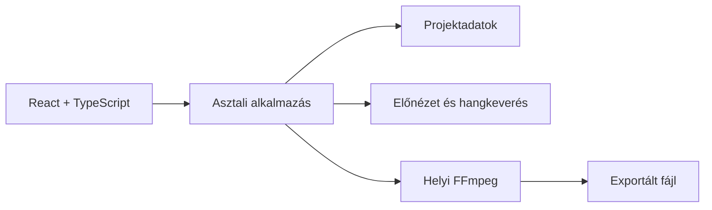

---
project_outline: "[[01-project-outline]]"
---

# Többsávos podcast-videószerkesztő

[Projektoutline](01-project-outline.md)

## 1. Szereplők és jogosultságok

| Szereplő | Feladat |
| --- | --- |
| Podcastkészítő | Projektet hoz létre, forrásokat ad hozzá, szerkeszt és exportál. |
| Alkalmazás karbantartója | A programot, a projektformátumot és a hibákat kezeli. |
| Hitelesítési szolgáltatás (ha szükséges) | Felhasználói fiókokat kezel; a média renderelését nem végzi. |

## 2. User case-ek

### Projekt létrehozása és források hozzáadása

- **Előfeltétel:** Az alkalmazás elindult.
- **Fő folyamat:**
  1. A felhasználó létrehoz egy projektet.
  2. Hozzáadja a hang- és videófájlokat.
  3. A rendszer ellenőrzi, hogy a fájlok elérhetők és feldolgozhatók-e.
  4. A felhasználó résztvevőket hoz létre, és forrásokat rendel hozzájuk.
  5. A projekt elmenthető.
- **Alternatív eset:** Ha egy fájl hiányzik vagy nem támogatott, a rendszer hibaüzenetet ad, a többi projektadatot pedig megtartja.
- **Utófeltétel:** A projekt és a források adatai elmentve maradnak.

### Szinkronizálás és szerkesztés

- **Előfeltétel:** A projekt legalább egy médiaforrást tartalmaz.
- **Fő folyamat:**
  1. A felhasználó a forrásokat közös idővonalon jeleníti meg.
  2. Beállítja az egyes források időeltolását.
  3. Kijelöli a kivágandó részeket.
  4. Megadja, hogy az egyes szakaszokban mely hangsávok és melyik videó legyen aktív.
  5. Beállítja a hangerőt és a pan–zoom értékeket.
  6. Előnézetben ellenőrzi az eredményt, majd menti a projektet.
- **Alternatív eset:** Érvénytelen időintervallum nem fogadható el. Hiányzó forrás esetén a rendszer figyelmeztet, de nem törli a szerkesztési adatokat.
- **Utófeltétel:** A szerkesztési beállítások később visszaállíthatók.

### Exportálás

- **Előfeltétel:** A szükséges források elérhetők, és a projekt szerkesztési állapota érvényes.
- **Fő folyamat:**
  1. A felhasználó videó- vagy hangexportot választ.
  2. Megadja a kimeneti fájl helyét.
  3. A rendszer ellenőrzi a beállításokat és elindítja a helyi renderelést.
  4. A folyamat alatt állapot-visszajelzést mutat.
  5. Befejezéskor ellenőrzi, hogy létrejött-e a kimenet.
- **Alternatív eset:** Sikertelen renderelés vagy hiányzó feldolgozó esetén a rendszer hibát jelez, és nem mutat sikeres exportot.
- **Utófeltétel:** Siker esetén elkészül a kimeneti fájl, hiba esetén a projektadatok megmaradnak.

## 3. Funkcionális követelmények

| Követelmény | Elfogadási kritérium | Prioritás |
| --- | --- | --- |
| Projekt létrehozása és mentése | A mentett projekt megjelenik a listában, és újranyitható. | Kötelező |
| Források hozzáadása | A támogatott fájl hozzáadásakor megjelennek az elérhető adatai. | Kötelező |
| Résztvevőkhöz rendelés | A hozzárendelés mentés után is megmarad. | Kötelező |
| Szinkroneltolás | Az eltolás módosítása a forrás időbeli helyét is módosítja. | Kötelező |
| Kivágás | A kijelölt rész nem szerepel a végső exportban. | Kötelező |
| Aktív hangsávok választása | Az adott szakaszban csak a kiválasztott hangok hallhatók. | Kötelező |
| Látható videó választása | Az adott szakaszban a kiválasztott videó jelenik meg. | Kötelező |
| Hangerőállítás | A hangerő beállítása az előnézetben és az exportban is érvényesül. | Kötelező |
| Pan–zoom | Az alapbeállítás és az idővonalas felülírás a megfelelő szakaszban érvényesül. | Kötelező |
| Előnézet | Az előnézet a szerkesztési beállításokat követi. | Kötelező |
| Videó- és hangexport | A rendszer helyben elkészíti a kiválasztott kimenettípust. | Kötelező |
| Projekt újranyitása | A vágások, eltolások és sávbeállítások visszaállnak. | Kötelező |
| Hibakezelés | Hiányzó fájlnál vagy sikertelen renderelésnél érthető hibaüzenet jelenik meg. | Kötelező |

## 4. Üzleti szabályok és korlátok

| Szabály | Indoklás |
| --- | --- |
| A kivágás kezdőpontja nem lehet a végpont után. | Hibás időintervallumok elkerülése. |
| A hang és a videó ugyanazt az idővonalat követi. | Az előnézet és az export összhangja miatt. |
| A renderelés a felhasználó gépén történik. | A médiafeldolgozás nem szerveroldali feladat. |
| A forrásfájl eltűnése nem törölheti a projekt adatait. | A szerkesztés később folytatható legyen. |
| Csak ellenőrzött kimenet jelezhető sikeres exportként. | A részleges vagy hibás fájl ne tűnjön késznek. |

## 5. Felület és munkafolyamat

A fő képernyőn a médiaforrások listája, az előnézet és az idővonal kap helyet. A felhasználó a kiválasztott sáv beállításait külön panelen módosíthatja, az export pedig külön műveletként indítható.

## 6. Nem funkcionális követelmények

| Követelmény | Ellenőrzés |
| --- | --- |
| A projektállapot újranyitható | Mentés, bezárás és újranyitás tesztje. |
| A renderelés nem fagyasztja le tartósan a felületet | Hosszabb export közbeni válaszkészség ellenőrzése. |
| Hibás fájl nem rontja el a projekt többi adatát | Hiányzó fájllal végzett teszt. |
| Az előnézet és az export követi a szerkesztést | Ismert vágásokat és hangerőket tartalmazó tesztprojekt. |
| A média helyben marad | A renderelés folyamatának ellenőrzése. |
| A repó nem tartalmaz titkokat | Konfiguráció és commitok ellenőrzése. |

## 7. Kezdeti technikai javaslat

Első lehetőségként Electron, React és TypeScript használata merült fel. Az előnézethez a HTML médiaelemei és a Web Audio API használható, a végső exportot pedig helyben futó FFmpeg végezheti. A projektadatokhoz verziózott projektleírás és helyi adatbázis használata vizsgálható.

| Megoldás | Előny | Hátrány / kérdés |
| --- | --- | --- |
| Electron | Webes technológiák és helyi folyamatok integrálása | Nagyobb alkalmazásméret |
| Tauri | Kisebb alapalkalmazás lehet | Több natív integrációs munka |
| Web Audio API | Több hangforrás előnézeti keverése | Nem oldja meg önmagában a teljes exportot |
| Helyi FFmpeg | Sokféle médiafeldolgozási feladat | Csomagolás, kodektámogatás és licenc ellenőrzése szükséges |

### Architektúravázlat

### Kockázatok és ellenőrzésük

- **Nagy fájlok:** tesztelni kell a memóriahasználatot és a renderelési időt.
- **Formátumok:** néhány gyakori formátummal prototípust kell készíteni; a pontos támogatást ezután lehet rögzíteni.
- **Előnézet és export eltérése:** ugyanazt a tesztprojektet mindkét folyamatban ellenőrizni kell.
- **Hiányzó forrás:** a rendszer jelezze a problémát, és tartsa meg a projekt beállításait.

